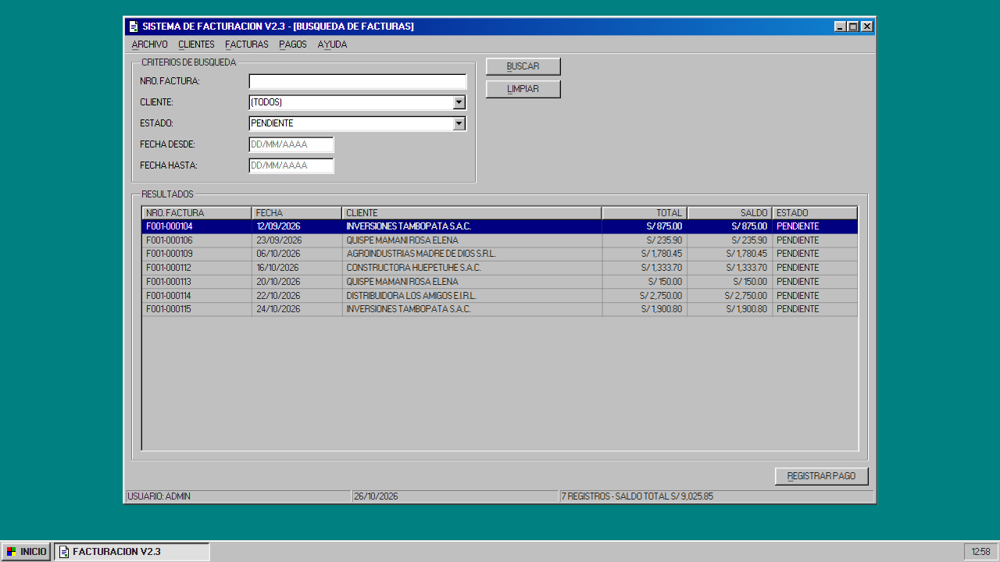

# Rewind

**Español** · [English](README.en.md)

> Built from scratch during the Meta Global AI Developer Hackathon (Oct 26 - Nov 4, 2026).
> Hecho desde cero durante el Meta Global AI Developer Hackathon (26 oct - 4 nov 2026).

Moderniza software antiguo a partir de un video, sin el código fuente. Grabas a alguien usando el programa viejo y un equipo de agentes reconstruye sus pantallas y flujos en una app web moderna, y luego verifica paso a paso que hace lo mismo.



## Cómo funciona

1. **Agente de pantallas**: extrae del video los cuadros clave, pantallas, campos y botones (SAM 3.1 + Muse Spark).
2. **Agente de flujos**: reconstruye los flujos de trabajo paso a paso (Muse Spark).
3. **Agente constructor**: genera una app web con las mismas pantallas y flujos.
4. **Agente verificador**: repite cada flujo en la app nueva y la compara con el video original.

Más detalle en [docs/arquitectura.md](docs/arquitectura.md).

## Estado

| Parte | Estado |
|---|---|
| App antigua de ejemplo (`legacy-demo/`) | Lista |
| Configuración de proveedor (Fireworks / Baseten) | Lista |
| Agentes 1 a 4 | En desarrollo |

## Tecnologías

Python 3.12 · uv · Flask · SQLite · 98.css · Muse Spark (vía Fireworks o Baseten, API compatible con OpenAI)

## Instalación

Requisitos: [uv](https://docs.astral.sh/uv/). uv descarga Python 3.12 por su cuenta si no lo tienes.

```
git clone https://github.com/JeffersonAreque/rewind.git
cd rewind
uv sync
cp .env.example .env    # luego pon tu clave y el modelo
```

## Uso

App antigua de ejemplo (usuario `admin`, clave `admin`):

```
uv run python legacy-demo/app.py --reset
```

Abre http://127.0.0.1:5000. Para grabarla y usarla como entrada, sigue [docs/grabar-video.md](docs/grabar-video.md).

Ver qué proveedor de modelos está activo:

```
uv run python -m rewind config
```

Para cambiar de proveedor, edita `REWIND_PROVIDER` en `.env` (`fireworks` o `baseten`).

Probar el proveedor con una llamada de texto y otra de visión (un cuadro del video de ejemplo). Muestra la respuesta y los tokens, nunca la clave; `--reasoning` muestra también el razonamiento del modelo:

```
uv run python scripts/check_provider.py
```

## Estructura

```
legacy-demo/   app antigua de ejemplo (Flask + SQLite + 98.css)
rewind/        pipeline de agentes en Python
docs/          arquitectura y guía de grabación
samples/       videos de entrada
scripts/       grabación automática del video de demo y prueba del proveedor
```

## Autor

Jefferson Areque, participación individual (pista Indie).

## Licencia

[MIT](LICENSE). 98.css (MIT) y la fuente MS Sans Serif (CC BY-SA 3.0) mantienen sus licencias; ver [legacy-demo/README.md](legacy-demo/README.md#créditos).
