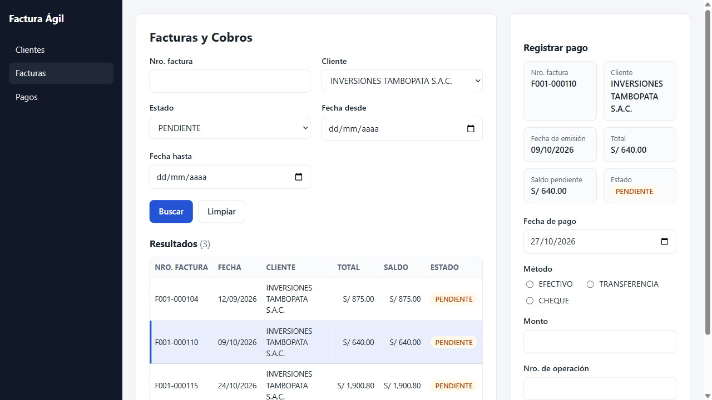

# Rewind

**Español** · [English](README.en.md)

> Built from scratch during the Meta Global AI Developer Hackathon (Oct 26 - Nov 4, 2026).
> Hecho desde cero durante el Meta Global AI Developer Hackathon (26 oct - 4 nov 2026).

Moderniza software antiguo a partir de un video, sin el código fuente. Grabas a alguien usando el programa viejo y un equipo de agentes reconstruye sus pantallas y flujos en una app web moderna, y luego verifica paso a paso que hace lo mismo.

| Antes: el programa antiguo (solo se ve en video) | Después: la app que generó Rewind |
|---|---|
|  |  |

## Cómo funciona

1. **Agente de pantallas**: extrae del video los cuadros clave, pantallas, campos, botones, tablas y diálogos.
2. **Agente de flujos**: reconstruye los flujos de trabajo paso a paso.
3. **Agente constructor**: genera una app web con las mismas pantallas y flujos.
4. **Agente verificador**: repite cada flujo en la app nueva y la compara con el video original.

**Muse Spark Open** (modelo de pesos abiertos de Meta, vía Baseten) es el núcleo y hace todo el trabajo. **SAM 3.1** es un complemento opcional: en una GPU de Modal encuentra cada campo del programa antiguo para marcarlo en el informe. Se activa con `REWIND_SEGMENTATION=sam`; nada depende de él.

Más detalle en [docs/arquitectura.md](docs/arquitectura.md).

## Estado

| Parte | Estado |
|---|---|
| App antigua de ejemplo (`legacy-demo/`) | Lista |
| Configuración de proveedor (Baseten / Fireworks) | Lista |
| Agente 1: pantallas | Listo: 100 % de acierto en facturación (110/110) y 99 % en la clínica (99/100) |
| Agente 2: flujos | Listo: 100 % en los dos videos (facturación: 29/29 pasos, 11/11 valores, 4/4 flujos, 7/7 reglas; clínica: 41/41, 12/12, 4/4, 6/6) |
| Agente 3: constructor | Listo: 4/4 flujos repetidos con éxito en cada app (9 cambios justificados en facturación, 7 en la clínica) |
| Agente 4: verificador | Listo: facturación 25/26 pasos y 10/10 reglas; clínica 35/38 pasos y 10/12 reglas; 0 fallas, el resto dudosos. Detecta 3 de 3 copias rotas en cada app |
| Segunda app: citas de una clínica, grabada rápido | Lista: otra estética, otro formato de errores y una regla nueva; sus resultados están en las filas de arriba |

## Tecnologías

Python 3.12 · uv · Muse Spark Open (vía Baseten o Fireworks, API compatible con OpenAI) · ffmpeg · numpy · pydantic · Flask · SQLite · 98.css

## Instalación

Requisitos: [uv](https://docs.astral.sh/uv/). uv descarga Python 3.12 por su cuenta si no lo tienes.

```
git clone https://github.com/JeffersonAreque/rewind.git
cd rewind
uv sync
cp .env.example .env    # luego pon tu clave y el modelo
```

## Uso

App antigua de ejemplo (usuario `admin`, clave `admin`):

```
uv run python legacy-demo/app.py --reset
```

Abre http://127.0.0.1:5000. Para grabarla y usarla como entrada, sigue [docs/grabar-video.md](docs/grabar-video.md).

Ver qué proveedor de modelos está activo:

```
uv run python -m rewind config
```

Para cambiar de proveedor, edita `REWIND_PROVIDER` en `.env` (`fireworks` o `baseten`).

Probar el proveedor con una llamada de texto y otra de visión (un cuadro del video de ejemplo). Muestra la respuesta y los tokens, nunca la clave; `--reasoning` muestra también el razonamiento del modelo:

```
uv run python scripts/check_provider.py
```

Todo de una vez: los 4 agentes sobre un video y un solo informe HTML (`runs/<id>/report.html`) con las pantallas antes y después, los flujos, las reglas, los cambios y la verificación paso a paso. El informe es un solo archivo con las imágenes adentro; `report` lo vuelve a escribir sin llamar al modelo:

```
uv run python -m rewind run samples/facturacion-demo.mp4
uv run python -m rewind run samples/clinica-demo.mp4
uv run python -m rewind report runs/<id>
```

Cada agente también se puede correr por separado.

Agente 1, pantallas (requiere ffmpeg). Analiza el video y guarda `runs/<id>/screens.json` más los cuadros clave; con `--dry-run` solo extrae los cuadros, sin gastar créditos:

```
uv run python -m rewind screens samples/facturacion-demo.mp4
uv run python scripts/eval_screens.py     # % de acierto contra samples/facturacion-demo.expected.json
```

Agente 2, flujos. Lee esa corrida y guarda `runs/<id>/flows.json`: los pasos del usuario, los flujos de negocio y las reglas. Los valores que leyó mal se marcan con confianza baja en vez de darse por buenos:

```
uv run python -m rewind flows runs/<id>
uv run python scripts/eval_flows.py       # % de pasos, valores, flujos y reglas
```

Agente 3, constructor. Genera la app moderna en `runs/<id>/app/` y repite en ella los flujos grabados. Muse Spark solo llena un spec en JSON validado; el código de la app es fijo y probado. `CHANGES.md` muestra cada cambio de modernización frente al programa antiguo, con su motivo y los pasos que lo justifican:

```
uv run python -m rewind build runs/<id>
uv run python runs/<id>/app/app.py        # http://127.0.0.1:5001 (usuario ADMIN; la clave se muestra al primer inicio)
```

Agente 4, verificador. Repite cada flujo en la app nueva con una captura después de cada paso, y Muse Spark compara cada captura con el cuadro clave del video. `VERIFICATION.md` muestra una tabla de pasa/falla por paso y por regla, con la imagen antigua y la nueva lado a lado y las diferencias encontradas:

```
uv run python -m rewind verify runs/<id>
uv run python scripts/eval_verifier.py    # debe detectar 3 copias rotas de la app
```

Pruebas sin llamadas al modelo:

```
uv run pytest
```

## Estructura

```
legacy-demo/   app antigua de ejemplo: facturación (Flask + SQLite + 98.css)
legacy-clinica/ segunda app antigua: citas de una clínica, otra estética y otras reglas
rewind/        pipeline de agentes en Python
docs/          arquitectura y guía de grabación
samples/       video de entrada, respuestas esperadas y un spec de ejemplo
scripts/       grabación del video, prueba del proveedor y prueba de precisión
tests/         pruebas sin API
```

## Autor

Jefferson Areque, participación individual (pista Indie).

## Licencia

[MIT](LICENSE). 98.css (MIT) y la fuente MS Sans Serif (CC BY-SA 3.0) mantienen sus licencias; ver [legacy-demo/README.md](legacy-demo/README.md#créditos).
